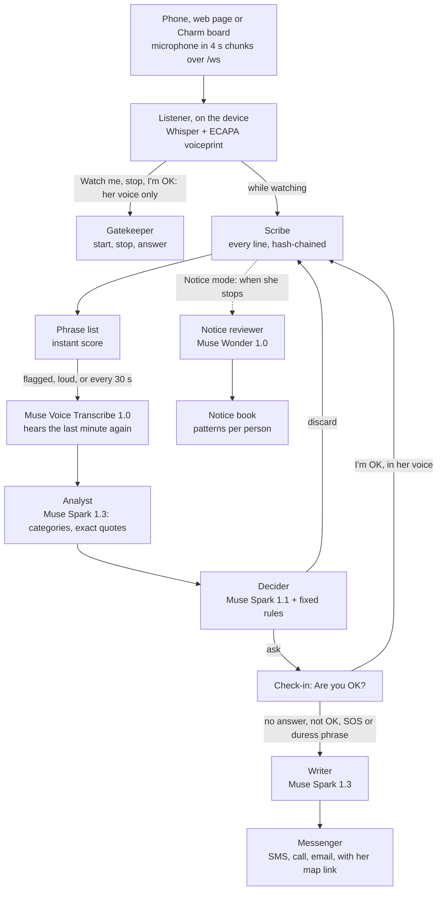

# Watch Me

[](https://github.com/hyper07/meta-hackathon-2026/actions/workflows/ci.yml)

A harassment and assault safety assistant, built for the Meta Global AI Developer Hackathon (2026). You say "Watch me"; only your voice can turn it off; and only you decide what happened. The server and web page are in [app/](app/README.md), the iPhone and Android app in [mobile/](mobile/README.md), and the demo video in [demo/](demo/).

<a href="https://github.com/hyper07/meta-hackathon-2026/raw/main/demo/watch-me-demo.mp4">
  
</a>

**▶ [Watch the full demo on YouTube (2:55)](https://www.youtube.com/watch?v=sOSY4PXw9Gg)**, or [as an MP4](https://github.com/hyper07/meta-hackathon-2026/raw/main/demo/watch-me-demo.mp4) with captions in [watch-me-demo.srt](demo/watch-me-demo.srt). The preview above shows three moments: "Are you OK?" (only her voice can answer "I'm OK"; the one button gets help) and the alert with her map link, a stranger's "stop watching" refused, and the Notice review with its pattern.

<p>


</p>

*The iPhone app on the iOS simulator, connected to the Watch Me server: Watch (light and dark), Notice, Review and Setup.*

### Next: Meta's Muse Charm

On the Charm, Watch Me runs in **stealth**: while it listens and watches, the pendant looks exactly like any other Charm, with its usual character on the screen and nothing that tells anyone nearby she is recording. The only Watch Me screen it ever shows is "Are you OK?", because she has to see it to answer.

<p>


</p>

*Concept renders made with Muse Image (Meta Model API, [demo/make/charm_images.py](demo/make/charm_images.py)), using a Meta product photo of the Charm and the app's real screens as references. Not photos of a working product: today Watch Me runs on the phone, and the Charm becomes its always-on microphone once Meta opens it to developers.*

#### Working today: a Charm-sized prototype

To try the stealth design on real hardware, Watch Me also runs on a small ESP32-C6 board with a 1.69" screen, a microphone and a speaker ([device/](device/README.md)). Its screen shows **Momo**, a round cat drawn in code. Momo looks the same whether Watch Me is listening or not; only the sparkles in its eyes turn to tiny hearts while it watches, a hint just for her. When the agents hear something wrong, Momo turns worried and asks "Are you OK?" on screen and out loud, with a countdown. "I'm OK" in her own voice makes Momo happy again; no answer alerts her people, and Momo goes straight back to its usual face, so nobody nearby can tell.

<p>


</p>

*The real board, filmed during a run: the party scene played from a laptop's speakers, Momo's microphone heard it, and the Muse agents decided to check in. It talks to the same Watch Me server as the phone app, over Wi-Fi or a USB cable.*

## Run it

You need macOS or Linux, [uv](https://docs.astral.sh/uv/) and Python 3.11+. For the phone app, you also need Node 20+, plus Xcode and CocoaPods (iPhone) or Android Studio and JDK 17 (Android).

**1. Add the key.** Every model agent runs on the Meta Model API. Without a key the app still runs, with the phrase list and fixed rules.

```bash
cp -n .env.example .env       # (-n keeps an existing .env) then set MODEL_API_KEY=<your Meta Model API key>
```

**2. Run the web app.**

```bash
cd app
uv sync                       # once: installs the server, Whisper and the voiceprint model
./run.sh                      # open http://127.0.0.1:8000
./run.sh --https              # https://<Wi-Fi IP>:8443, for a phone's browser on the same Wi-Fi (needs mkcert; see app/README.md)
```

Or with Docker, without installing Python or uv: `docker compose up --build`, then open http://localhost:8000. It reads `.env` from step 1 and runs on the CPU. The first start downloads Whisper and the voiceprint model into a volume.

Open Setup, enter your name, PIN and contacts, and record your voice: one line, said once. Then go to Watch, turn on listening and say "Watch me".

**3. Build and run the iPhone or Android app.** It uses native modules, so it needs a development build; Expo Go won't work.

```bash
cd app && ./run.sh --lan      # in one terminal: the server for the app; prints the address, e.g. 192.168.1.20:8000

cd mobile                     # in another terminal
npm install
npx expo run:ios              # the iOS simulator or a connected iPhone
npx expo run:android          # an Android emulator or a connected phone
```

In the app, open Setup › Server, enter the address `run.sh --lan` printed, and tap Connect. Without a Mac or Android Studio, Expo can build it in the cloud: `npx eas-cli@latest build:configure` once, then `npx eas-cli@latest build --profile development`.

**4. Test it.**

```bash
cd app
uv run python -m pytest       # 32 tests; speech is faked, so no microphone needed
uv run python -m scenarios.build && uv run python -m scenarios.evaluate   # the 22 realistic scenes (app/scenarios/)
cd .. && uvx pytest tests     # 11 tests of the Charm board's USB link: framing, CRC, audio chunks
```

GitHub Actions runs both test suites and builds the Docker image on every push. The measured results, and a script that runs them again, are in [benchmarks/](benchmarks/README.md).

## What was built during the hackathon

The building period was Oct 27 – Nov 4, 2026. Everything that runs was written during it.

- **Before the event (Oct 18), no code.** The idea and planning notes only: [MODELS.md](MODELS.md), [SAFETY_AND_LAW.md](SAFETY_AND_LAW.md), and early drafts of this README and [DESIGN.md](DESIGN.md), which then described a "harassment and assault safety assistant" concept.
- **Built during the hackathon:**
  - [app/](app/README.md): the server and its agents, the voice lock, Emergency and Notice modes, offline catch-up, and the web page;
  - [app/scenarios/](app/scenarios/README.md): the 22 test scenes, 56 written cases and the evaluator, summarised in [benchmarks/](benchmarks/README.md);
  - [mobile/](mobile/README.md): the iPhone and Android app;
  - [demo/](demo/): the video, screenshots, Charm concept images and the scripts that make them;
  - [device/](device/README.md): a Charm stand-in on an ESP32-C6 board, with Momo the cat on its screen, and its USB bridge;
  - the tests, CI and the Docker image, and the measurements in the docs.
- **Open-source parts used, not written by us:** Whisper (faster-whisper, the offline fallback) and SpeechBrain's ECAPA voiceprint model; FastAPI; Expo and React Native; the Kokoro and Chatterbox voices, used only for the demo and test scenes.

**Meta models in the project** (problem statement: *Build for Your World*):

| Meta model | Where it's used |
|---|---|
| Muse Spark 1.3 (Meta Model API) | the live Analyst, the alert text, session summaries |
| Muse Spark 1.1 (Meta Model API) | the Decider: a probability for discard, ask and alert, in about 2 s |
| Muse Wonder 1.0 (Meta Model API) | the Notice reviewer: which exact words match how the EEOC describes harassment |
| Muse Voice Transcribe 1.0 (Meta Model API) | what the Analyst reads: the last minute, transcribed again before each analysis (in noisy scenes it made far fewer errors than Whisper on whole stretches); audio kept while offline, once the connection is back; spoken Notice accounts; checking the demo's synthetic voices. Whisper on the device does the fast 4-second live chunks |
| Muse Image 1.0 (Meta Model API) | the Muse Charm concept images |

**How the agents fit together** (Emergency mode; [DESIGN.md](DESIGN.md) has the details):



**Measured on the 22 test scenes** (11 harmful, 9 harmless, 2 school and work; synthetic voices over party, bar, street and TV noise; details in [app/scenarios/](app/scenarios/README.md#speech-to-text-whisper-on-this-machine-or-muse-voice-transcribe)):

| What's heard | Who judges it | Started | Harmful asked | Needless | Check-in (median) |
|---|---|---|---|---|---|
| Whisper, 4 s chunks | Muse agents, reading Whisper's lines | 20 of 22 | 9 of 11 | 0 of 9 | 5.4 s |
| Muse Voice Transcribe, 4 s chunks | Muse agents, reading Muse's lines | 19 of 22 | 8 of 11 | 0 of 9 | 9.5 s |
| **Whisper, 4 s chunks (the app today)** | **Muse agents, reading Muse Voice Transcribe's last minute** | **20 of 22** | **9 of 11** | **0 of 9** | **5.4 s** |
| Muse Voice Transcribe's transcript of the whole recording | Muse agents | 19 of 22 | 10 of 11 | 0 of 9 | 9.5 s |
| The script, word for word (perfect hearing) | Muse agents | 22 of 22 | **11 of 11** | **0 of 9** | 6.2 s |
| The script, word for word | phrase list and fixed rules | 22 of 22 | 10 of 11 | 2 of 9 | 9.1 s |

- **Given a perfect transcript, the Muse agents get every scene right:** 11 of 11 harmful scenes asked "Are you OK?" and no needless check-ins. The app's remaining misses come from hearing in noise and the voice lock, not from the agents' judgment.
- **On the same transcript, a phrase list** missed one harmful scene and raised two false alarms: "I'll kill you" quoted from a film, and someone else's story retold. The Muse agents read the context and discarded both.
- **Muse Voice Transcribe** heard "Watch me" in every scene, but its turn times are too coarse for the voiceprint, so 3 sessions didn't start. That's why the live voice lock stays on Whisper's word timings.

These are single runs on scripted, synthetic scenes: good for comparing versions, not a claim about real-world accuracy.

## The idea

A system that:

- recognizes when a conversation is about harassment or sexual assault (emails, messages, chats);
- helps the person involved make sense of what happened;
- keeps the evidence safe;
- points them to legal options and support.

It also covers emergencies. If someone may be in danger right now, for example unconscious after being drugged, it reaches the people they chose in advance.

The motivating case is campus sexual assault. In 2026 a former student's lawsuit, reported by the AP, said she "felt like bait" at a fraternity party in 2024 and that she had been given ketamine; she went to campus police three weeks later ([ABC News/AP, 2026-10-03](https://abcnews.com/US/wireStory/woman-told-cornell-investigators-felt-bait-alleged-gang-136963907); [NBC New York](https://www.nbcnewyork.com/new-york/woman-cornell-investigators-felt-like-bait-alleged-gang-rape/6555069/)). The accusations are disputed and investigations are ongoing, so the pitch describes them as allegations and doesn't name the school. Someone who has been drugged cannot answer "are you OK?". That is the case Watch Me is built for. Many victims never file a report. They talk to friends first, or to no one. The aim is to meet them where those conversations already happen, with support they control.

### Domestic violence

The same danger is often at home, from someone the person knows:

- **More than 1 in 3 women** (about 43.5 million) and **more than 1 in 6 men** (20.7 million) in the US have experienced contact sexual violence, physical violence or stalking by an intimate partner ([CDC, NISVS 2023/2024 data brief](https://www.cdc.gov/intimate-partner-violence/about/index.html)).
- **Over half of female homicide victims** in the US are killed by a current or former male partner ([CDC](https://www.cdc.gov/intimate-partner-violence/about/index.html), from 2015 data in 27 states).
- Worldwide, **about 50,000 women and girls** were killed by a partner or family member in 2024: 137 a day, almost one every 10 minutes ([UN Women and UNODC, 2025](https://www.unwomen.org/en/news-stories/press-release/2025/11/every-day-137-women-and-girls-are-killed-by-intimate-partners-or-family-members)).
- **Only 56%** of nonfatal domestic violence is reported to police. The reasons victims gave for not reporting include privacy (32%), shielding the offender (21%) and fear of retaliation (19%) ([Bureau of Justice Statistics, 2006–2015](https://bjs.ojp.gov/content/pub/pdf/prdv0615.pdf)).

Watch Me fits this case because it was built for a person who can't safely reach for a phone:

- **Hands-free.** She starts it by saying "Watch me". On the Charm, once it ships, it would look like any other pendant, so a partner sees nothing to take away.
- **Only her voice turns it off.** "Stop watching" in anyone else's voice is refused, and the PIN is a fallback only she knows.
- **The duress phrase.** If she is forced to switch it off, she says the duress phrase. Watch Me looks switched off, keeps listening, and alerts the people she chose.
- **"Are you OK?"** When the agents hear threats or violence, Watch Me asks first. If she can't answer, it alerts the people she chose. It never calls anyone just because the model judged the scene.
- **A dated record.** Every session and Notice entry goes into a dated log in which each line carries the hash of the one before, so any change or deletion shows. Advocates help survivors put together exactly this kind of timeline for a protective order. Recording laws still apply; see [SAFETY_AND_LAW.md](SAFETY_AND_LAW.md).

Partners who abuse also use technology to monitor and control. That is why Watch Me only installs on the owner's own device and only listens to conversations she is part of (see [What it must not become](#what-it-must-not-become)). In the US, the National Domestic Violence Hotline is 1-800-799-7233, or text START to 88788.

## What it does

1. **Detect.** Flag messages and conversations that suggest harassment, coercion, threats, drugging or assault. Each flag gets a risk level and the exact lines that triggered it.
2. **Assess.** An AI agent explains why it flagged the conversation and asks the user what they want to do. Trained human advocates review high-risk cases.
3. **Preserve evidence.** Save the flagged messages, screenshots and any recordings the user makes. Each item is timestamped, hashed and encrypted, in a vault only the user controls.
4. **Inform.** Give plain-language legal information and next steps for the user's location: campus Title IX office, police report, protective orders, hotlines. It refers to lawyers and advocates instead of giving legal advice itself (see [SAFETY_AND_LAW.md](SAFETY_AND_LAW.md)).
5. **Protect.** If an emergency trigger fires, alert the emergency contacts the user chose in advance, with a location if the user allowed it. The triggers include a missed safety check-in during a night out and an "I'm not OK" phrase.
6. **Watch Me**, the safety mode, built in [app/](app/README.md) (phone now, Meta's **Muse Charm** pendant once it ships):
   - The owner says "Watch me" for a party, a date or a walk home. Only their voice, checked against a voiceprint, can start or stop it. Setting up the voiceprint takes one line, said once.
   - It transcribes what it hears, telling the owner apart from other voices. The lines are scored as they come in, colour-coded for later review, and the audio around flagged moments is kept.
   - A team of agents works on it. Muse Spark analyses and quotes the exact words. Muse Spark, as the Decider, gives a probability for discard, ask or alert in about 2 s, and fixed rules make it ask when unsure.
   - It first asks the owner "Are you OK?". If there is no answer, or they say the SOS phrase, it texts, calls and emails the people they chose. A duress phrase makes it look switched off while it keeps listening and sends the alert.
   - The alert carries her location as a map link, with its accuracy and, if the phone hasn't reported in a while, the time of the last known fix. The app adds the link itself, so the model can never drop it. The email also lists her earlier positions. While Watch Me is still on after an alert, her people get a new link each time she moves 150 m or more (at most every 2 minutes, for an hour).
7. **Notice**, for school and work, built in [app/](app/README.md). Harassment there is often a "joke" or a comment people only recognise later. She tells the app what happened (or records a class or meeting where one-party consent applies). Muse Spark shows which exact words match how the EEOC and the Department of Education describe harassment, and links each definition. Every entry goes into a dated, hash-chained record, with patterns counted per person ("3 times from Prof. R since Oct 14"). No alerts, no verdicts: only she decides what it was.

## What it must not become

A tool that reads other people's private conversations to find victims without their knowledge would itself be surveillance. It would also be illegal in many places. Everything here is **opt-in, user-controlled and on the user's side** (see [SAFETY_AND_LAW.md](SAFETY_AND_LAW.md)). The design reaches people who haven't reported through consent-based channels instead:

- **Shared group consent:** friends who opt in together as a "circle".
- **Self-installed use:** the person installs it for their own messages.
- **Organization channels:** for example a campus app where students choose to enable the feature.

## Documents

- [app/README.md](app/README.md): the Watch Me app: how to run it, its agents, and measured timings
- [mobile/README.md](mobile/README.md): the iPhone and Android app (React Native, Expo): listens with the screen locked
- [device/README.md](device/README.md): the Charm prototype on an ESP32-C6 board
- [benchmarks/README.md](benchmarks/README.md): what was measured, the results, and how to run them again
- [DESIGN.md](DESIGN.md): the system, its components and how data flows
- [MODELS.md](MODELS.md): which models, how to train them, and the JEPA question
- [SAFETY_AND_LAW.md](SAFETY_AND_LAW.md): consent, privacy, recording laws, legal information versus legal advice
- [PLAN.md](PLAN.md): the nine-day build plan and the demo
