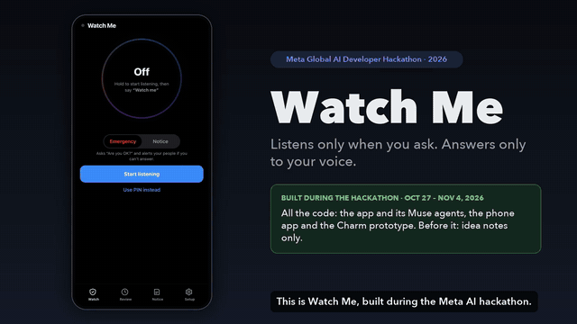
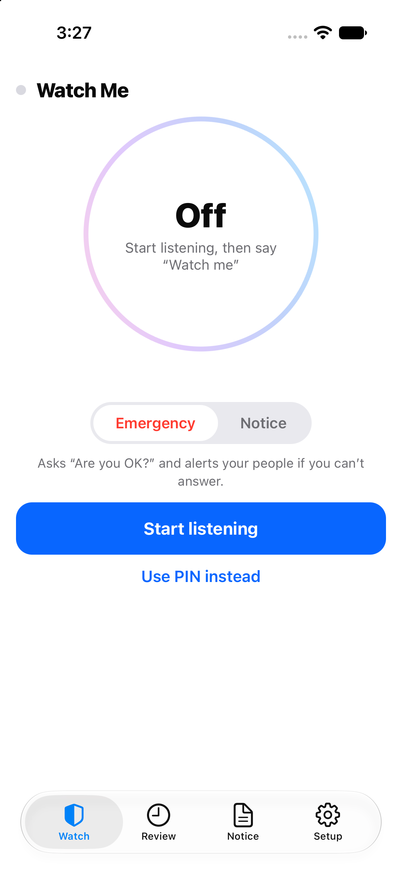
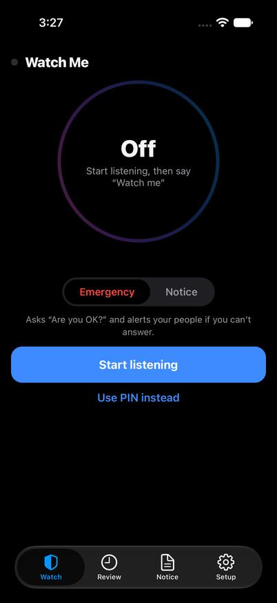
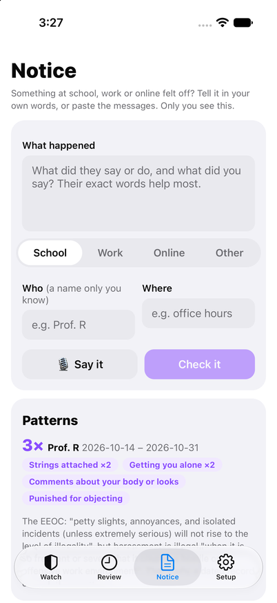
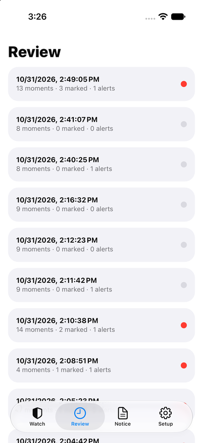
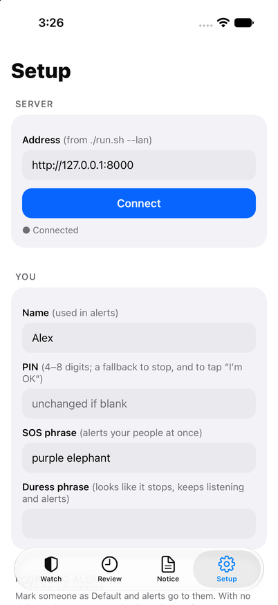
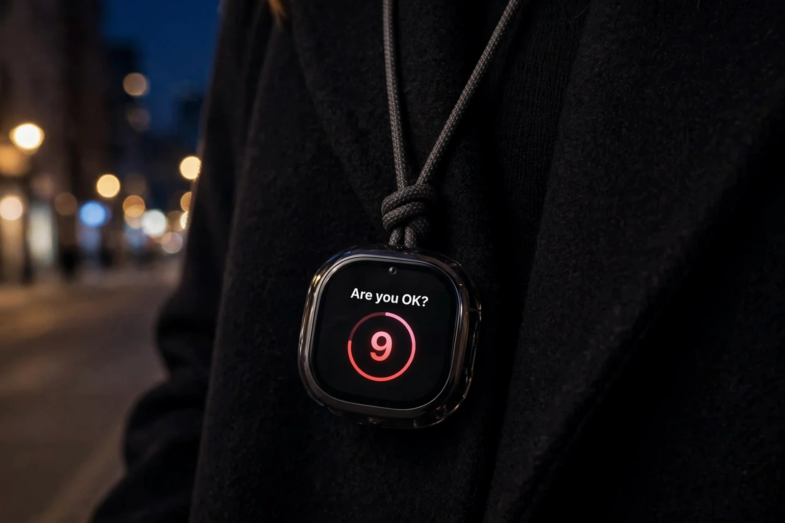

# Watch Me

A harassment and assault safety assistant, built for the Meta Global AI Developer Hackathon (2026). You say "Watch me"; only your voice can turn it off; and only you decide what happened. The server and web page are in [app/](app/README.md), the iPhone and Android app in [mobile/](mobile/README.md), and the demo video in [demo/](demo/).

**▶ [Watch the full demo (2:51, MP4)](https://github.com/hyper07/meta-hackathon-2026/raw/main/demo/watch-me-demo.mp4)**, with captions in [watch-me-demo.srt](demo/watch-me-demo.srt). The preview above shows three moments: "Are you OK?" and the alert, a stranger's "stop watching" refused, and the Notice review with its pattern.

*The iPhone app on the iOS simulator, connected to the Watch Me server: Watch (light and dark), Notice, Review and Setup.*

### Next: Meta's Muse Charm

On the Charm, Watch Me runs in **stealth**: while it listens and watches, the pendant looks exactly like any other Charm, with its usual character on the screen and nothing that tells anyone nearby she is recording. The only Watch Me screen it ever shows is "Are you OK?", because she has to see it to answer.

*Concept renders made with Muse Image (Meta Model API, [demo/make/charm_images.py](demo/make/charm_images.py)), using a Meta product photo of the Charm and the app's real screens as references. Not photos of a working product: today Watch Me runs on the phone, and the Charm becomes its always-on microphone once Meta opens it to developers.*

## The idea

A system that:

- recognizes when a conversation is about harassment or sexual assault (emails, messages, chats);
- helps the person involved make sense of what happened;
- keeps the evidence safe;
- points them to legal options and support.

It also covers emergencies. If someone may be in danger right now, for example unconscious after being drugged, it reaches the people they chose in advance.

The motivating case is campus sexual assault. In 2026 a former student's lawsuit, reported by the AP, said she "felt like bait" at a fraternity party in 2024 and that she had been given ketamine; she went to campus police three weeks later ([ABC News/AP, 2026-10-03](https://abcnews.com/US/wireStory/woman-told-cornell-investigators-felt-bait-alleged-gang-136963907); [NBC New York](https://www.nbcnewyork.com/new-york/woman-cornell-investigators-felt-like-bait-alleged-gang-rape/6555069/)). The accusations are disputed and investigations are ongoing, so the pitch describes them as allegations and doesn't name the school. Someone who has been drugged cannot answer "are you OK?". That is the case Watch Me is built for. Many victims never file a report. They talk to friends first, or to no one. The aim is to meet them where those conversations already happen, with support they control.

## What it does

1. **Detect.** Flag messages and conversations that suggest harassment, coercion, threats, drugging or assault. Each flag gets a risk level and the exact lines that triggered it.
2. **Assess.** An AI agent explains why it flagged the conversation and asks the user what they want to do. Trained human advocates review high-risk cases.
3. **Preserve evidence.** Save the flagged messages, screenshots and any recordings the user makes. Each item is timestamped, hashed and encrypted, in a vault only the user controls.
4. **Inform.** Give plain-language legal information and next steps for the user's location: campus Title IX office, police report, protective orders, hotlines. It refers to lawyers and advocates instead of giving legal advice itself (see [SAFETY_AND_LAW.md](SAFETY_AND_LAW.md)).
5. **Protect.** If an emergency trigger fires, alert the emergency contacts the user chose in advance, with a location if the user allowed it. The triggers include a missed safety check-in during a night out and an "I'm not OK" phrase.
6. **Watch Me**, the safety mode, built in [app/](app/README.md) (phone now, Meta's **Muse Charm** pendant once it ships):
   - The owner says "Watch me" for a party, a date or a walk home. Only their voice, checked against a voiceprint, can start or stop it.
   - It transcribes what it hears, telling the owner apart from other voices. The lines are scored as they come in, colour-coded for later review, and the audio around flagged moments is kept.
   - A team of agents works on it. Muse Spark analyses and quotes the exact words. A Jev-style decision model chooses discard, ask or alert in about 0.1 s, and asks when unsure.
   - It first asks the owner "Are you OK?". If there is no answer, or they say the SOS phrase, it texts, calls and emails the people they chose. A duress phrase makes it look switched off while it keeps listening and sends the alert.
7. **Notice**, for school and work, built in [app/](app/README.md). Harassment there is often a "joke" or a comment people only recognise later. She tells the app what happened (or records a class or meeting where one-party consent applies). Muse Spark shows which exact words match how the EEOC and the Department of Education describe harassment, and links each definition. Every entry goes into a dated, hash-chained record, with patterns counted per person ("3 times from Prof. R since Oct 14"). No alerts, no verdicts: only she decides what it was.

## What it must not become

A tool that reads other people's private conversations to find victims without their knowledge would itself be surveillance. It would also be illegal in many places. Everything here is **opt-in, user-controlled and on the user's side** (see [SAFETY_AND_LAW.md](SAFETY_AND_LAW.md)). The design reaches people who haven't reported through consent-based channels instead:

- **Shared group consent:** friends who opt in together as a "circle".
- **Self-installed use:** the person installs it for their own messages.
- **Organization channels:** for example a campus app where students choose to enable the feature.

## Hackathon facts (from the event page, 2026-10-18)

| Item | Detail |
|---|---|
| Applications | open Oct 13, close **Oct 25, 11:59 PM ET** (or earlier if 20,000 spots fill) |
| Event | starts **Oct 26** with a kickoff livestream; workshops and Discord office hours Oct 27 to Nov 4 |
| Submission | **Nov 4, 9:00 PM ET** |
| Results | judging Nov 4 to 8, winners announced Nov 9 |
| Format | virtual, worldwide, free if selected |
| Tracks | Indie (individuals, students) or Startup (teams); themes: "Build for Your World" or "Push the Frontier" |
| Suggested tools | Muse Spark series, Muse Image and SAM 3.1 through the Meta Model API; Meta open-weights models; Muse Code |
| Judging | Indie: creativity, technical ambition, whether it works. Startup: technical execution, production readiness |

The official rules are published before Oct 26 and must be read before building: data use, licences, demo requirements.

## Documents

- [app/README.md](app/README.md): the Watch Me app: how to run it, its agents, and measured timings
- [mobile/README.md](mobile/README.md): the iPhone and Android app (React Native, Expo): listens with the screen locked
- [DESIGN.md](DESIGN.md): the system, its components and how data flows
- [MODELS.md](MODELS.md): which models, how to train them, and the JEPA question
- [SAFETY_AND_LAW.md](SAFETY_AND_LAW.md): consent, privacy, recording laws, legal information versus legal advice
- [PLAN.md](PLAN.md): the nine-day build plan and the demo
