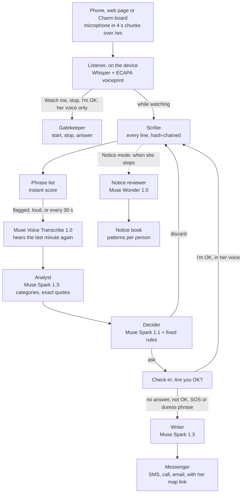

# Watch Me

**A voice-locked safety assistant for a party, a date, the walk home, and home itself.** She says "Watch me". A team of Muse agents listens for threats, coercion and signs of drugging, and asks "Are you OK?" when something is wrong. If she can't answer, the people she chose get a text, a call and an email, with what it heard and a map of where she is. Only her voice can turn it off, and only she decides what happened. It is a multi-model pipeline with deterministic checks, not a prompt: an ECAPA voiceprint and Whisper on the device gate every command; Muse Voice Transcribe re-hears the last minute; Muse Spark 1.3 analyses it and may only quote words that are in the transcript; Muse Spark 1.1 gives probabilities that fixed rules turn into discard, ask or alert, so a model alone can never discard a real risk or send an alert; Muse Wonder reviews Notice accounts; and the app itself, not a model, adds the map link and keeps the hash-chained record. Every model runs on the Meta Model API; the voice lock and live speech-to-text run locally.

[](https://www.youtube.com/watch?v=sOSY4PXw9Gg)
[](https://github.com/hyper07/meta-hackathon-2026/actions/workflows/ci.yml)
[](LICENSE)
[](app/pyproject.toml)
[](#meta-global-ai-developer-hackathon-2026-submission-overview)
[](app/pyproject.toml)
[](mobile/package.json)
[](compose.yaml)

## Meta Global AI Developer Hackathon 2026: submission overview

| | |
|---|---|
| **Track · problem statement** | Indie Developer · Build for Your World |
| **Hackathon provenance** (Oct 26 – Nov 4, 2026) | Built from scratch during the hackathon window: work began Oct 27, and the repository was first committed and published on Oct 31 (38 commits since). Before it: idea notes only, no code ([what was built when](#what-was-built-during-the-hackathon)) |
| **Meta AI runtime models** (Meta Model API) | `muse-spark-1.3`: the Analyst and the alert writer · `muse-spark-1.1`: the Decider · `muse-wonder-1.0`: the Notice reviewer · `muse-voice-transcribe-1.0`: re-hears the last minute, transcribes audio kept offline and spoken accounts · `muse-image-1.0`: the Charm concept images ([Built with Meta](#built-with-meta)). No open weights, no fine-tuning |
| **3-minute demo video** | https://www.youtube.com/watch?v=sOSY4PXw9Gg (2:55; the provenance line is spoken and on screen at 0:00) |
| **Quickstart & keyless mode** | `cp -n .env.example .env`, set `MODEL_API_KEY`, then `docker compose up --build` (http://localhost:8000) or `cd app && uv sync && ./run.sh` ([Run it](#run-it)). With no key, the whole check-in loop still runs on the device: Whisper, the voiceprint, the phrase list and the fixed rules. Alerts are a dry run until Twilio or SMTP keys are set. Recorded runs of the real models, scene by scene, are in [app/scenarios/results/](app/scenarios/results/) ([keyless mode and recorded traces](#without-a-key-and-recorded-traces)) |
| **Measured** | Accuracy: 9 of 11 harmful scenes asked "Are you OK?", 0 of 9 needless check-ins; 11 of 11 given a perfect transcript; 40 of 40 public training cases from the EEOC and NY State. Latency: Whisper hears a 4 s chunk in 0.34 s and the voiceprint takes 27 ms on the device; the Decider answers in 3.1 s (median of 20) ([Benchmarks](#benchmarks)) |
| **Bonus prize category targeted** | Best Agentic Use-Case: five agents on Muse models (Analyst, Decider, Writer, Notice reviewer, and Muse Voice Transcribe re-hearing the last minute), with fixed rules that decide to discard, ask or alert |
| **Next devices** | Meta's Muse Charm pendant (a stealth design, already prototyped on an ESP32-C6 board) · Meta's AI glasses (hands-free, with the check-in in her ear) |
| **Where things are** | [app/](app/README.md): the server, agents and web page · [mobile/](mobile/README.md): the iPhone and Android app · [device/](device/README.md): a Charm stand-in on an ESP32-C6 board · [demo/](demo/): the video and how it's made |
| **Stack** | Python 3.11+, FastAPI, faster-whisper, SpeechBrain ECAPA, PyTorch (CPU) · Expo SDK 58, React Native 0.88, TypeScript · ESP32-C6 (Arduino) · Docker · GitHub Actions |
| **License** | [Apache-2.0](LICENSE) |

## Contents

- [The demo](#the-demo) · [Next: Meta's Muse Charm](#next-metas-muse-charm) · [Meta's AI glasses](#also-metas-ai-glasses)
- [Run it](#run-it) · [Without a key, and recorded traces](#without-a-key-and-recorded-traces) · [Configuration](#configuration)
- [Built with Meta](#built-with-meta): which model does what, and how the agents fit together
- [Benchmarks](#benchmarks): accuracy, the Notice reviewer, the voice lock, latency
- [Code layout](#code-layout)
- [What was built during the hackathon](#what-was-built-during-the-hackathon)
- [The idea](#the-idea) · [Domestic violence](#domestic-violence) · [What it does](#what-it-does) · [What it must not become](#what-it-must-not-become)
- [Documents](#documents) · [License](#license)

## The demo

<a href="https://github.com/hyper07/meta-hackathon-2026/raw/main/demo/watch-me-demo.mp4">
  
</a>

**▶ [Watch the full demo on YouTube (2:55)](https://www.youtube.com/watch?v=sOSY4PXw9Gg)**, or [as an MP4](https://github.com/hyper07/meta-hackathon-2026/raw/main/demo/watch-me-demo.mp4) with captions in [watch-me-demo.srt](demo/watch-me-demo.srt). The preview above shows the opening (built during the hackathon, with the live app beside it) and three moments: "Are you OK?" (only her voice can answer "I'm OK"; the one button gets help) and the alert with her map link, a stranger's "stop watching" refused, and the Notice review with its pattern.

<p>


</p>

*The iPhone app on the iOS simulator, connected to the Watch Me server: Watch (light and dark), Notice, Review and Setup.*

### Next: Meta's Muse Charm

On the Charm, Watch Me runs in **stealth**: while it listens and watches, the pendant looks exactly like any other Charm, with its usual character on the screen and nothing that tells anyone nearby she is recording. The only Watch Me screen it ever shows is "Are you OK?", because she has to see it to answer.

<p>


</p>

*Concept renders made with Muse Image (Meta Model API, [demo/make/charm_images.py](demo/make/charm_images.py)), using a Meta product photo of the Charm and the app's real screens as references. Not photos of a working product: today Watch Me runs on the phone, and the Charm becomes its always-on microphone once Meta opens it to developers.*

#### Working today: a Charm-sized prototype

To try the stealth design on real hardware, Watch Me also runs on a small ESP32-C6 board with a 1.69" screen, a microphone and a speaker ([device/](device/README.md)). Its screen shows **Momo**, a round cat drawn in code. Momo looks the same whether Watch Me is listening or not; only the sparkles in its eyes turn to tiny hearts while it watches, a hint just for her. When the agents hear something wrong, Momo turns worried and asks "Are you OK?" on screen and out loud, with a countdown. "I'm OK" in her own voice makes Momo happy again; no answer alerts her people, and Momo goes straight back to its usual face, so nobody nearby can tell.

<p>


</p>

*The real board, filmed during a run: the party scene played from a laptop's speakers, Momo's microphone heard it, and the Muse agents decided to check in. It talks to the same Watch Me server as the phone app, over Wi-Fi or a USB cable.*

#### Also: Meta's AI glasses

Watch Me can be adapted to Meta's AI glasses (Ray-Ban Meta, Oakley Meta, Meta Ray-Ban Display), and they suit it well:
- **Hands-free by design.** Watch Me is already voice-only: "Watch me", "stop watching" and "I'm OK" are all spoken, and nothing needs a tap.
- **"Are you OK?" in her ear.** The check-in can be spoken through the open-ear speakers, so only she hears it. On Meta Ray-Ban Display it can also appear privately in the lens, with its countdown.
- **No new server work.** The server takes 16 kHz audio over `/ws` from any client: the phone app, the web page and the ESP32 board already do. The glasses' microphones would reach it through the phone app, which pairs with them. Meta's Wearables Device Access Toolkit is the way to build on the glasses directly.

Not built or tested yet: this is the next step after the phone, alongside the Charm.

## Run it

You need macOS or Linux, [uv](https://docs.astral.sh/uv/) and Python 3.11+. For the phone app, you also need Node 20+, plus Xcode and CocoaPods (iPhone) or Android Studio and JDK 17 (Android).

**1. Add the key.** Every model agent runs on the Meta Model API. Without a key the app still runs, with the phrase list and fixed rules.

```bash
cp -n .env.example .env       # (-n keeps an existing .env) then set MODEL_API_KEY=<your Meta Model API key>
```

**2. Run the web app.**

```bash
cd app
uv sync                       # once: installs the server, Whisper and the voiceprint model
./run.sh                      # open http://127.0.0.1:8000
./run.sh --https              # https://<Wi-Fi IP>:8443, for a phone's browser on the same Wi-Fi (needs mkcert; see app/README.md)
```

Or with Docker, without installing Python or uv: `docker compose up --build`, then open http://localhost:8000. It reads `.env` from step 1 and runs on the CPU. The first start downloads Whisper and the voiceprint model into a volume.

Open Setup, enter your name, PIN and contacts, and record your voice: one line, said once. Then go to Watch, turn on listening and say "Watch me".

**3. Build and run the iPhone or Android app.** It uses native modules, so it needs a development build; Expo Go won't work.

```bash
cd app && ./run.sh --lan      # in one terminal: the server for the app; prints the address, e.g. 192.168.1.20:8000

cd mobile                     # in another terminal
npm install
npx expo run:ios              # the iOS simulator or a connected iPhone
npx expo run:android          # an Android emulator or a connected phone
```

In the app, open Setup › Server, enter the address `run.sh --lan` printed, and tap Connect. Without a Mac or Android Studio, Expo can build it in the cloud: `npx eas-cli@latest build:configure` once, then `npx eas-cli@latest build --profile development`.

**4. Test it.**

```bash
cd app
uv run python -m pytest       # 32 tests; speech is faked, so no microphone needed
uv run python -m scenarios.build && uv run python -m scenarios.evaluate   # the 22 realistic scenes (app/scenarios/)
cd .. && uvx pytest tests     # 11 tests of the Charm board's USB link: framing, CRC, audio chunks
```

GitHub Actions runs both test suites, type-checks and lints the phone app, and builds the Docker image on every push. The measured results, and the scripts that run them again, are in [benchmarks/](benchmarks/README.md).

### Without a key, and recorded traces

Judges can check Watch Me without a Meta key and without special hardware:

- **Keyless mode.** With no `MODEL_API_KEY`, the app runs the whole Emergency loop on the device: Whisper hears the 4-second chunks, the ECAPA voiceprint locks start, stop and "I'm OK" to her voice, the phrase list scores each line, and the fixed rules ask "Are you OK?" and alert when there's no answer. Setup › "Models and services" shows what is configured. Alerts are a dry run, shown on screen and in the log, until Twilio or SMTP keys are set; the evaluator forces a dry run whatever is in `.env`.
- **Recorded traces.** Every evaluation run is kept in [app/scenarios/results/](app/scenarios/results/) as JSON and a Markdown table. For each of the 22 scenes: who said what, the Analyst's score and reason for every segment, the Decider's three probabilities and the rule it applied, and when the check-in came. [benchmarks/results/](benchmarks/results/) keeps the latency runs with every raw timing. The runs behind the numbers in this README are named next to them.
- **Deterministic runner.** `./benchmarks/run.sh` re-runs the phrase-list baseline on the scenes and on their scripts with no key (the scenes are rendered once, with the `scenarios` dependency group); `--agents` adds the Muse runs, and `benchmarks/latency.py` times every stage.

### Configuration

Everything is in [.env.example](.env.example), and all of it is optional. The main settings:

| Variable | Default | Purpose |
|---|---|---|
| `MODEL_API_KEY` (or `META_API_KEY`) | empty | the Meta Model API key from [dev.meta.ai](https://dev.meta.ai); without it: phrase list, fixed rules, dry-run alerts |
| `ANALYST_MODEL` · `DECIDER_MODEL` · `REVIEWER_MODEL` · `WRITER_MODEL` | `muse-spark-1.3` · `muse-spark-1.1` · `muse-wonder-1.0` · `muse-spark-1.3` | the model behind each agent |
| `LLM_REASONING_EFFORT` | `low` | higher efforts can spend the whole token budget on reasoning |
| `STT_ENGINE` · `ANALYST_STT` | `whisper` · `muse` | the live 4 s chunks; what the Analyst reads (the last minute, re-heard by Muse Voice Transcribe) |
| `WHISPER_MODEL` | `base` | `tiny`, `base` or `small` |
| `VOICE_THRESHOLD` · `VOICE_STRICT_THRESHOLD` | `0.20` · `0.36` | the voiceprint match to start; to stop or say "I'm OK" |
| `CHECKIN_TIMEOUT_S` · `URGENT_CHECKIN_TIMEOUT_S` | `30` · `15` | how long "Are you OK?" waits for her |
| `RECORDING_RULE` | `one-party` | `all-party`: never keep audio, text notes only |
| `TWILIO_ACCOUNT_SID` · `TWILIO_AUTH_TOKEN` · `TWILIO_FROM` | empty | real SMS and calls; empty: dry run |
| `SMTP_HOST` · `SMTP_PORT` · `SMTP_USER` · `SMTP_PASSWORD` | empty · `587` | real email; empty: dry run |
| `DATA_DIR` | `app/data` | the profile, logs and clips (`/data` in Docker) |

`.env` is git-ignored and never copied into the Docker image; compose reads it at run time.

## Built with Meta

Every model agent runs on the **Meta Model API** (`api.meta.ai`, with `MODEL_API_KEY`), from [app/watchme/muse.py](app/watchme/muse.py), [decider.py](app/watchme/decider.py), [notice.py](app/watchme/notice.py) and [speech.py](app/watchme/speech.py). Each asks for JSON and checks it: a quote the model can't point to in the transcript is dropped, probabilities are normalised and then judged by fixed rules, and the alert's map link is added by the app.

| Agent | Model | What it does |
|---|---|---|
| Analyst | `muse-spark-1.3` | scores the last minute, names the categories and quotes the exact words; a quote not in the transcript is dropped |
| Decider | `muse-spark-1.1` | a probability each for discard, ask and alert; fixed rules turn them into the action and ask when unsure |
| Writer | `muse-spark-1.3` | the alert text and session summaries; the app adds the map link itself; a template takes over on a timeout |
| Notice reviewer | `muse-wonder-1.0` | which exact words match how the EEOC describes harassment, and which description |
| The last minute, again | `muse-voice-transcribe-1.0` | re-transcribes the last minute before each analysis (far fewer errors than Whisper in noise); audio kept while offline, once the connection is back; spoken Notice accounts, with speaker turns |
| Concept art | `muse-image-1.0` | the Muse Charm concept images |
| Listener, on the device | Whisper base and SpeechBrain ECAPA (open source, not Meta) | the live 4-second chunks, and the voiceprint that locks start, stop and "I'm OK" to her voice |

**Why each model.** Each agent got the model that measured best for its job ([app/scenarios/README.md](app/scenarios/README.md#which-model-for-which-agent)): Muse Wonder was right on 40 of 40 public harassment cases, against 38 for Spark 1.3 and 36 for Spark 1.1; as the Decider, Spark 1.1 made the same decisions as Spark 1.3 in a fraction of the time; Muse Voice Transcribe made far fewer errors than Whisper on whole stretches in noise (8% against 57% of words in the noisiest party scene), while Whisper's word timings keep the voice lock tight on 4-second chunks.

**How the agents fit together** (Emergency mode; [DESIGN.md](DESIGN.md) has the details):



## Benchmarks

Measured with the app's own code on 22 scripted scenes (11 harmful, 9 harmless including hard cases, 2 school and work), voiced by synthetic voices over party, bar, street and TV noise, and streamed through the real agents in the same 4-second chunks the phone sends. Method, limits and every raw result: [benchmarks/](benchmarks/README.md) and [app/scenarios/](app/scenarios/README.md). These are single runs on scripted scenes written by the people who built the app: good for comparing versions, not a claim about real-world accuracy.

### Accuracy: does it ask "Are you OK?" when it should, and only then?

| What's heard | Who judges it | Started | Harmful asked | Needless | Check-in (median) |
|---|---|---|---|---|---|
| Whisper, 4 s chunks | Muse agents, reading Whisper's lines | 20 of 22 | 9 of 11 | 0 of 9 | 5.4 s |
| Muse Voice Transcribe, 4 s chunks | Muse agents, reading Muse's lines | 19 of 22 | 8 of 11 | 0 of 9 | 9.5 s |
| **Whisper, 4 s chunks (the app today)** | **Muse agents, reading Muse Voice Transcribe's last minute** | **20 of 22** | **9 of 11** | **0 of 9** | **5.4 s** |
| Muse Voice Transcribe's transcript of the whole recording | Muse agents | 19 of 22 | 10 of 11 | 0 of 9 | 9.5 s |
| The script, word for word (perfect hearing) | Muse agents | 22 of 22 | **11 of 11** | **0 of 9** | 6.2 s |
| The script, word for word | phrase list and fixed rules | 22 of 22 | 10 of 11 | 2 of 9 | 9.1 s |

- **Given a perfect transcript, the Muse agents get every scene right:** 11 of 11 harmful scenes asked "Are you OK?" and no needless check-ins. The app's remaining misses come from hearing in noise and the voice lock, not from the agents' judgment.
- **On the same transcript, a phrase list** missed one harmful scene and raised two false alarms: "I'll kill you" quoted from a film, and someone else's story retold. The Muse agents read the context and discarded both.
- **Muse Voice Transcribe** heard "Watch me" in every scene, but its turn times are too coarse for the voiceprint, so 3 sessions didn't start. That's why the live voice lock stays on Whisper's word timings.

### The Notice reviewer

| Model | 40 public EEOC and NY State training cases | Our 16 cases | Median time |
|---|---|---|---|
| **Muse Wonder 1.0 (chosen)** | **40 of 40** | **16 of 16** | 4.5 s |
| Muse Spark 1.3 | 38 of 40 | 16 of 16 | 5.4 s |
| Muse Spark 1.1 | 36 of 40 | 16 of 16 | 2.3 s |

### The voice lock: only her voice stops it or says "I'm OK"

ECAPA voiceprints, scored per sentence as the app does: 61 of her sentences and 70 from 15 other voices. The closest other voice scored 0.328; the bar to stop or say "I'm OK" is 0.36, and no other voice passed it. The bar to start is 0.20, and it accepted her "Watch me" in 18 of 19 scenes. The model it replaced (WavLM-SV) let similar female voices score 0.88–0.92, as high as she did.

### Latency

Measured on 2026-11-03: 20 runs of each Meta Model API stage after a warm-up, 50 of each local stage, on an Apple Silicon Mac with no GPU ([benchmarks/results/latency-20261103-2336.md](benchmarks/results/latency-20261103-2336.md), every timing in the JSON next to it). `cd app && uv run python ../benchmarks/latency.py` runs it again.

| Stage | Where | median | p90 | max | failed |
|---|---|---|---|---|---|
| Whisper base, one 4 s chunk | on the device | 0.34 s | 0.35 s | 0.36 s | 0 of 50 |
| ECAPA voiceprint, one sentence | on the device | 27 ms | 30 ms | 34 ms | 0 of 50 |
| Phrase list, a whole scene | on the device | 0.1 ms | 0.2 ms | 0.2 ms | 0 of 50 |
| Muse Voice Transcribe 1.0, the last minute | Meta Model API | 3.8 s | 4.7 s | 5.9 s | 0 of 20 |
| Analyst, Muse Spark 1.3 | Meta Model API | 7.4 s | 8.8 s | 9.5 s | 0 of 20 |
| Decider, Muse Spark 1.1 | Meta Model API | 3.1 s | 4.3 s | 5.3 s | 0 of 20 |
| Alert text, Muse Spark 1.3 | Meta Model API | 6.3 s | 7.7 s | 7.9 s | 2 of 20 (the template took over) |
| Notice review, Muse Wonder 1.0 | Meta Model API | 4.8 s | 7.0 s | 8.8 s | 0 of 20 |

What that means for her:

- **On the device, the loop is fast enough to be invisible.** A 4-second chunk is transcribed in 0.34 s and the voiceprint checked in 27 ms, so "Watch me", "stop watching" and "I'm OK" are answered within the chunk they're said in, online or offline.
- **The Muse path adds about 14 s of model time** before a check-in that needed the agents: transcribe 3.8 s, Analyst 7.4 s, Decider 3.1 s, one after the other (median 14.3 s, p90 16.3 s), on top of the 4-second chunk. The phrase list scores each line instantly and marks it for the Analyst; if the API is off or fails, the fixed rules ask on that score alone. On the scenes' own clock, with model time not added, the check-in came a median 5.4 s after the first harmful line.
- **The alert never waits on a model.** The writer has a 10 s limit; 2 of 20 calls fell back to the template, and the alert still went out at once with the map link, which the app adds itself.
- **The API's speed varies by time of day.** On 2026-10-31 the Analyst took 2.6–4.1 s and the Decider about 2 s ([app/README.md](app/README.md)); on 2026-11-03, 7.4 s and 3.1 s. The table shows the later, fuller measurement.

## Code layout

```
app/                        the Watch Me server (Python 3.11+, FastAPI)
  watchme/
    main.py                 the web server: the page, /ws for audio, setup, voice enrollment, review
    session.py              one owner, one session: Listener, Gatekeeper, Scribe, check-ins, alerts, location, offline catch-up
    speech.py               Whisper and the ECAPA voiceprint, on this machine; Muse Voice Transcribe
    commands.py             "Watch me", "stop watching", "I'm OK", the SOS and duress phrases, matched in the transcript
    lexicon.py              the instant phrase list: a first score for every line
    muse.py                 Muse Spark through the Meta Model API: the Analyst, the alert writer, summaries
    decider.py              the Decider: Muse Spark's probabilities, then the fixed rules
    notice.py               Notice mode: the Muse Wonder review, the notice book, patterns per person
    messenger.py            SMS, voice calls (Twilio) and email (SMTP), or a dry run
    store.py                the profile and the hash-chained evidence log
    config.py               settings, from .env
  static/                   the phone web page (index.html, app.js, app.css) and its spoken prompts
  scenarios/                the 22 test scenes, 56 written Notice cases, the evaluator, and results/
  tests/                    32 server tests (speech is faked)
mobile/src/                 the iPhone and Android app (Expo SDK 58, React Native 0.88, TypeScript)
  app/                      the Watch, Review, Notice and Setup screens (expo-router)
  components/               the orb, the check-in sheet, toasts
  lib/                      the server link (/ws, PCM audio), the theme
device/                     a Charm stand-in on an ESP32-C6 board
  watchme-charm/            the firmware (Arduino): Momo on screen, the microphone and speaker, Wi-Fi or USB
  bridge.py, momo_demo.py   the USB link to the server; the demo scenes played at the board
demo/                       the video, its captions, the preview GIF, screenshots, Charm images; make/ builds them
benchmarks/                 the measured results, latency.py, run.sh, and results/
tests/                      11 tests of the board's USB link
Dockerfile, compose.yaml    the server in a container
.github/workflows/ci.yml    server tests, bridge tests, phone app type-check and lint, Docker build
DESIGN.md, MODELS.md, SAFETY_AND_LAW.md, PLAN.md   the design notes
```

## What was built during the hackathon

The building period was Oct 27 – Nov 4, 2026. Everything that runs was written during it.

- **Before the event (Oct 18), no code.** The idea and planning notes only: [MODELS.md](MODELS.md), [SAFETY_AND_LAW.md](SAFETY_AND_LAW.md), and early drafts of this README and [DESIGN.md](DESIGN.md), which then described a "harassment and assault safety assistant" concept.
- **Built during the hackathon:**
  - [app/](app/README.md): the server and its agents, the voice lock, Emergency and Notice modes, offline catch-up, and the web page;
  - [app/scenarios/](app/scenarios/README.md): the 22 test scenes, 56 written cases and the evaluator, summarised in [benchmarks/](benchmarks/README.md);
  - [mobile/](mobile/README.md): the iPhone and Android app;
  - [demo/](demo/): the video, screenshots, Charm concept images and the scripts that make them;
  - [device/](device/README.md): a Charm stand-in on an ESP32-C6 board, with Momo the cat on its screen, and its USB bridge;
  - the tests, CI and the Docker image, and the measurements in the docs.
- **Open-source parts used, not written by us:** Whisper (faster-whisper, the offline fallback) and SpeechBrain's ECAPA voiceprint model; FastAPI; Expo and React Native; the Kokoro and Chatterbox voices, used only for the demo and test scenes.

## The idea

A system that:

- recognizes when a conversation is about harassment or sexual assault (emails, messages, chats);
- helps the person involved make sense of what happened;
- keeps the evidence safe;
- points them to legal options and support.

It also covers emergencies. If someone may be in danger right now, for example unconscious after being drugged, it reaches the people they chose in advance.

The motivating case is campus sexual assault. In 2026 a former student's lawsuit, reported by the AP, said she "felt like bait" at a fraternity party in 2024 and that she had been given ketamine; she went to campus police three weeks later ([ABC News/AP, 2026-10-03](https://abcnews.com/US/wireStory/woman-told-cornell-investigators-felt-bait-alleged-gang-136963907); [NBC New York](https://www.nbcnewyork.com/new-york/woman-cornell-investigators-felt-like-bait-alleged-gang-rape/6555069/)). The accusations are disputed and investigations are ongoing, so the pitch describes them as allegations and doesn't name the school. Someone who has been drugged cannot answer "are you OK?". That is the case Watch Me is built for. Many victims never file a report. They talk to friends first, or to no one. The aim is to meet them where those conversations already happen, with support they control.

### Domestic violence

The same danger is often at home, from someone the person knows:

- **More than 1 in 3 women** (about 43.5 million) and **more than 1 in 6 men** (20.7 million) in the US have experienced contact sexual violence, physical violence or stalking by an intimate partner ([CDC, NISVS 2023/2024 data brief](https://www.cdc.gov/intimate-partner-violence/about/index.html)).
- **Over half of female homicide victims** in the US are killed by a current or former male partner ([CDC](https://www.cdc.gov/intimate-partner-violence/about/index.html), from 2015 data in 27 states).
- Worldwide, **about 50,000 women and girls** were killed by a partner or family member in 2024: 137 a day, almost one every 10 minutes ([UN Women and UNODC, 2025](https://www.unwomen.org/en/news-stories/press-release/2025/11/every-day-137-women-and-girls-are-killed-by-intimate-partners-or-family-members)).
- **Only 56%** of nonfatal domestic violence is reported to police. The reasons victims gave for not reporting include privacy (32%), shielding the offender (21%) and fear of retaliation (19%) ([Bureau of Justice Statistics, 2006–2015](https://bjs.ojp.gov/content/pub/pdf/prdv0615.pdf)).

Watch Me fits this case because it was built for a person who can't safely reach for a phone:

- **Hands-free.** She starts it by saying "Watch me". On the Charm, once it ships, it would look like any other pendant, so a partner sees nothing to take away.
- **Only her voice turns it off.** "Stop watching" in anyone else's voice is refused, and the PIN is a fallback only she knows.
- **The duress phrase.** If she is forced to switch it off, she says the duress phrase. Watch Me looks switched off, keeps listening, and alerts the people she chose.
- **"Are you OK?"** When the agents hear threats or violence, Watch Me asks first. If she can't answer, it alerts the people she chose. It never calls anyone just because the model judged the scene.
- **A dated record.** Every session and Notice entry goes into a dated log in which each line carries the hash of the one before, so any change or deletion shows. Advocates help survivors put together exactly this kind of timeline for a protective order. Recording laws still apply; see [SAFETY_AND_LAW.md](SAFETY_AND_LAW.md).

Partners who abuse also use technology to monitor and control. That is why Watch Me only installs on the owner's own device and only listens to conversations she is part of (see [What it must not become](#what-it-must-not-become)). In the US, the National Domestic Violence Hotline is 1-800-799-7233, or text START to 88788.

## What it does

1. **Detect.** Flag messages and conversations that suggest harassment, coercion, threats, drugging or assault. Each flag gets a risk level and the exact lines that triggered it.
2. **Assess.** An AI agent explains why it flagged the conversation and asks the user what they want to do. Trained human advocates review high-risk cases.
3. **Preserve evidence.** Save the flagged messages, screenshots and any recordings the user makes. Each item is timestamped, hashed and encrypted, in a vault only the user controls.
4. **Inform.** Give plain-language legal information and next steps for the user's location: campus Title IX office, police report, protective orders, hotlines. It refers to lawyers and advocates instead of giving legal advice itself (see [SAFETY_AND_LAW.md](SAFETY_AND_LAW.md)).
5. **Protect.** If an emergency trigger fires, alert the emergency contacts the user chose in advance, with a location if the user allowed it. The triggers include a missed safety check-in during a night out and an "I'm not OK" phrase.
6. **Watch Me**, the safety mode, built in [app/](app/README.md) (phone now, Meta's **Muse Charm** pendant once it ships):
   - The owner says "Watch me" for a party, a date or a walk home. Only their voice, checked against a voiceprint, can start or stop it. Setting up the voiceprint takes one line, said once.
   - It transcribes what it hears, telling the owner apart from other voices. The lines are scored as they come in, colour-coded for later review, and the audio around flagged moments is kept.
   - A team of agents works on it. Muse Spark analyses and quotes the exact words. Muse Spark, as the Decider, gives a probability for discard, ask or alert in about 3 s ([latency](#latency)), and fixed rules make it ask when unsure.
   - It first asks the owner "Are you OK?". If there is no answer, or they say the SOS phrase, it texts, calls and emails the people they chose. A duress phrase makes it look switched off while it keeps listening and sends the alert.
   - The alert carries her location as a map link, with its accuracy and, if the phone hasn't reported in a while, the time of the last known fix. The app adds the link itself, so the model can never drop it. The email also lists her earlier positions. While Watch Me is still on after an alert, her people get a new link each time she moves 150 m or more (at most every 2 minutes, for an hour).
7. **Notice**, for school and work, built in [app/](app/README.md). Harassment there is often a "joke" or a comment people only recognise later. She tells the app what happened (or records a class or meeting where one-party consent applies). Muse Spark shows which exact words match how the EEOC and the Department of Education describe harassment, and links each definition. Every entry goes into a dated, hash-chained record, with patterns counted per person ("3 times from Prof. R since Oct 14"). No alerts, no verdicts: only she decides what it was.

## What it must not become

A tool that reads other people's private conversations to find victims without their knowledge would itself be surveillance. It would also be illegal in many places. Everything here is **opt-in, user-controlled and on the user's side** (see [SAFETY_AND_LAW.md](SAFETY_AND_LAW.md)). The design reaches people who haven't reported through consent-based channels instead:

- **Shared group consent:** friends who opt in together as a "circle".
- **Self-installed use:** the person installs it for their own messages.
- **Organization channels:** for example a campus app where students choose to enable the feature.

## Documents

- [app/README.md](app/README.md): the Watch Me app: how to run it, its agents, and measured timings
- [mobile/README.md](mobile/README.md): the iPhone and Android app (React Native, Expo): listens with the screen locked
- [device/README.md](device/README.md): the Charm prototype on an ESP32-C6 board
- [benchmarks/README.md](benchmarks/README.md): what was measured, the results, and how to run them again
- [DESIGN.md](DESIGN.md): the system, its components and how data flows
- [MODELS.md](MODELS.md): which models, how to train them, and the JEPA question
- [SAFETY_AND_LAW.md](SAFETY_AND_LAW.md): consent, privacy, recording laws, legal information versus legal advice
- [PLAN.md](PLAN.md): the nine-day build plan and the demo

## License

Copyright 2026 Kibaek Kim. Licensed under the [Apache License 2.0](LICENSE).

Parts written by others keep their own licenses: Espressif's ES8311 codec driver in [device/watchme-charm/](device/watchme-charm/) (Apache-2.0) and the Expo template parts of [mobile/](mobile/LICENSE) (MIT). The app uses Whisper through faster-whisper (MIT) and SpeechBrain's ECAPA voiceprint model (Apache-2.0); the demo's synthetic voices come from Kokoro (Apache-2.0) and Chatterbox (MIT). Using the Meta Model API is subject to Meta's terms.
