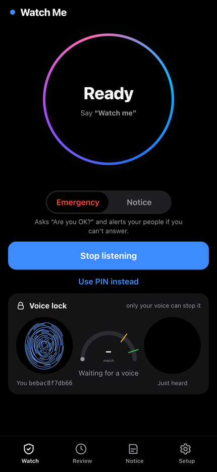
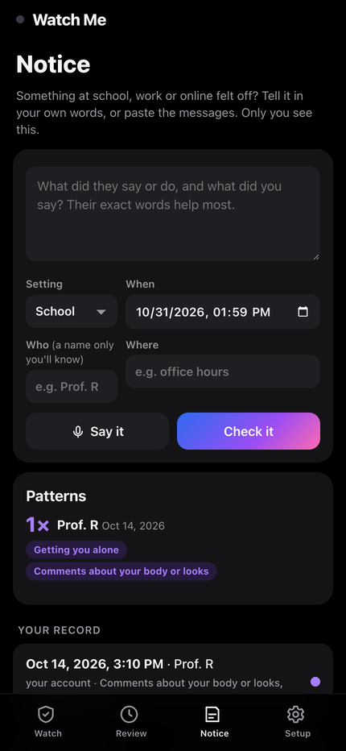
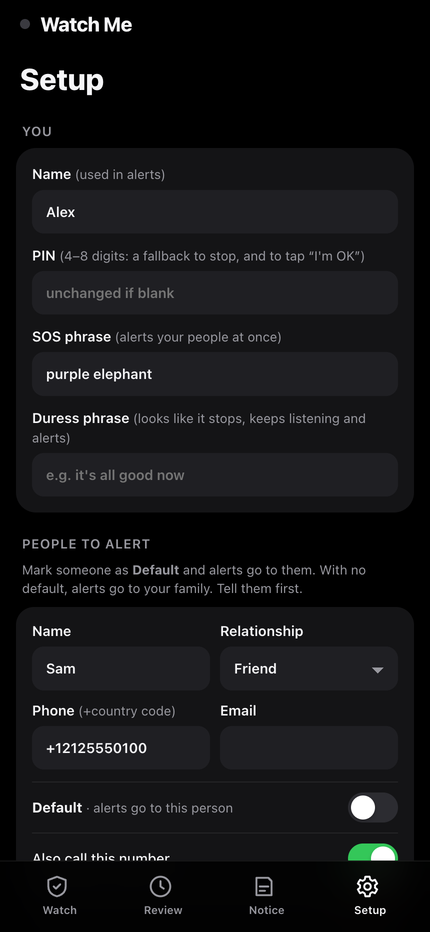
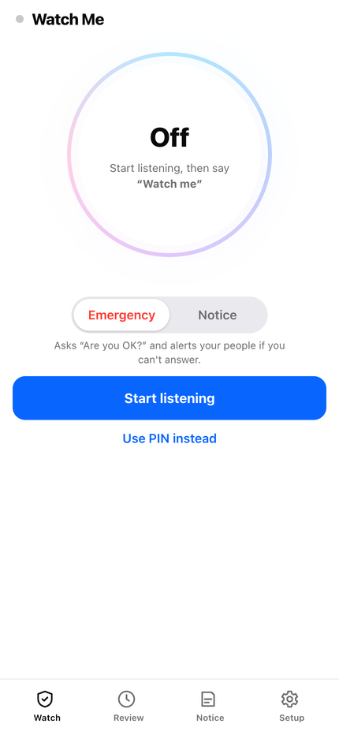

# Watch Me

The owner says **"Watch me"**. The phone listens, turns what it hears into text, and a team of agents watches for harassment, sexual harassment, coercion, threats and drugging. When something sounds wrong, it privately asks **"Are you OK?"**. If the owner doesn't answer, it texts, calls and emails the people the owner chose. Afterwards the owner can review the session as a timeline: every moment is colour-coded by risk, flagged audio is kept, and the whole log is hash-chained so any later edit shows.

Only the owner's voice can start or stop it.

<p>




</p>

**Notice mode** is for school, work and online, where harassment is often a "joke", a comment about your looks or your accent, a grade mentioned next to an invitation, or messages that won't stop, and people only realise later, or never. Nothing interrupts or alerts. Afterwards, Watch Me shows which words match how the EEOC describes harassment, with the exact quotes and links to the definitions:
- sexual harassment;
- harassment because of race, color, national origin, religion, age, disability, sexual orientation or gender identity, or pregnancy;
- threats, retaliation and bullying;
- online abuse. It keeps a dated, hash-chained record, and counts patterns per person ("3 times from Prof. R since Oct 14"). Two ways in:
- **"Tell me what happened"**: she types it, says it, or pastes the messages afterwards. This is legal everywhere, because nobody else is recorded, and the audio isn't kept. Spoken accounts are transcribed by Muse Voice Transcribe.
- **Live**: switch the Watch tab to Notice and say "Watch me". Allowed only with `RECORDING_RULE=one-party`.

It never says "you were harassed": it says which words match which description, and that only she decides what it was.

## Run it

```bash
cd app
uv sync                 # once
./run.sh                # http://127.0.0.1:8000 on this computer
./run.sh --https        # https://<Wi-Fi IP>:8443 for a phone on the same Wi-Fi
uv run python -m pytest # 73 tests; speech is faked, so no microphone needed
uv run python -m scenarios.build && uv run python -m scenarios.evaluate   # 22 realistic scenes, see scenarios/
```

Keys go in the repo-root `.env`; copy [.env.example](../.env.example) (`cp -n .env.example .env` from the repo root). Everything is optional:

| Set | You get | Without it |
|---|---|---|
| `MODEL_API_KEY` (or `META_API_KEY`) | every model agent on the Meta Model API (`api.meta.ai`): Muse Spark as Analyst, Decider and writer, Muse Wonder for Notice, Muse Voice Transcribe for speech-to-text. This is all the app needs. | phrase list and fixed rules |
| `TWILIO_*` | real SMS and voice calls | dry run: shown on screen and in the log |
| `SMTP_*` | real email | dry run |

**First time:** open Setup. Enter your name, a PIN, an SOS phrase, an optional duress phrase and your contacts, then tap "Record my voice" and say the one line shown, once. It is cut into three overlapping pieces; how well they agree says whether the recording was clean. Then go to Watch, turn on listening and say "Watch me".

### On your phone

A phone browser only gives the microphone to an `https` page. `./run.sh --https` makes a certificate for your Mac's Wi-Fi address with mkcert. The phone must trust mkcert's root certificate once:

1. Run `mkcert -CAROOT` and send `rootCA.pem` from that folder to the phone (AirDrop or email).
2. **iPhone:** open the file, then Settings › Profile Downloaded › Install. Then Settings › General › About › Certificate Trust Settings › turn on mkcert.
   **Android:** Settings › Security › Encryption & credentials › Install a certificate › CA certificate.
3. Open `https://<Wi-Fi IP>:8443` on the phone.

Keep the screen on: the page asks for a wake lock, but a phone browser stops the microphone when the screen locks. A native app (or the Muse Charm) removes this limit.

## The agents

```
 phone mic ──4 s chunks──▶ Listener ── Whisper sentences, on this machine (in standby, only for "Watch me")
                               │          + a voiceprint per sentence (ECAPA, on this machine)
                               │
                               ▼
                           Gatekeeper ── "watch me" (match ≥ 70%) / "stop watching", "I'm OK" (≥ 90%): owner only
                               │          SOS phrase: alert now · duress phrase: look off, keep going, alert
                               ▼ while watching
                           Scribe ── every line, score and decision, hash-chained; audio of flagged moments
                               │
              phrase list ─────┤ instant score, colours the line
                               ▼ marked, loud, or every 30 s
                           Analyst ── Muse Voice Transcribe re-hears the last minute (speaker turns),
                               │       then Muse Spark: categories, exact quotes (checked), score, reason
                               ▼ score ≥ 0.45
                           Decider ── Muse Spark 1.1: discard / ask / alert probabilities, ~2 s
                               │       rules: discard only if p ≥ 0.83; "alert" → urgent ask
                               ▼ ask
                           Check-in ── "Are you OK?" (vibrate + voice), 30 s (15 s urgent)
                               │       answered by owner's voice, PIN tap, or "Get help"
                               ▼ no answer · "not OK" · SOS · duress · phone drops off
                           Messenger ── Muse Spark writes it; Twilio SMS + call, email
```

| File | What it is |
|---|---|
| [watchme/session.py](watchme/session.py) | the session and the agents: Listener, Gatekeeper, Scribe, Analyst hand-off, Decider hand-off, Check-in, escalation |
| [watchme/speech.py](watchme/speech.py) | Whisper and Muse Voice Transcribe, sentence splitting and trimming, the ECAPA voiceprint, the 0–100% display match |
| [scenarios/](scenarios/README.md) | 20 realistic test scenes (Kokoro voices, background noise), the evaluator, and how the voice lock was calibrated |
| [watchme/commands.py](watchme/commands.py) | voice commands |
| [watchme/lexicon.py](watchme/lexicon.py) | the instant phrase list (a starting list; refine with advocates) |
| [watchme/notice.py](watchme/notice.py) | Notice mode: the types with their EEOC and Department of Education sources, the review, the notice book, patterns, export |
| [watchme/muse.py](watchme/muse.py) | Analyst, alert writer, session summary |
| [watchme/decider.py](watchme/decider.py) | the Decider: Muse Spark's probabilities and the "ask when unsure" rules |
| [watchme/messenger.py](watchme/messenger.py) | Twilio and SMTP |
| [watchme/store.py](watchme/store.py) | profile, append-only hash-chained log, clips |
| [static/](static/) | the phone page: Watch (the orb, Emergency or Notice, the voice lock), Review, Notice, Setup; one HTML file, one stylesheet, one script, no framework |
| [static/voice/](static/voice/) | what the app says out loud (“Are you OK? Say I'm OK, or tap the screen.”, “Alerting your people now.”): recorded files in a natural synthetic voice (Chatterbox, see [../demo/make/](../demo/make/README.md)); the browser's own speech is only the fallback |

## Models per agent

Each agent can use its own model (`ANALYST_MODEL`, `DECIDER_MODEL`, `REVIEWER_MODEL`, `WRITER_MODEL`, `STT_ENGINE`, `ANALYST_STT`). The defaults were chosen by measurement; see [scenarios/README.md](scenarios/README.md#which-model-for-which-agent).

| Agent | Model |
|---|---|
| Listener (live 4-second chunks) | Whisper base, on this machine: 0.3 s a chunk, fewer errors than Muse on short chunks, and tight clips for the voice lock |
| What the Analyst reads | Muse Voice Transcribe 1.0: the last minute, transcribed again in one request before each analysis, each turn labelled you or someone else by the voiceprint. On whole stretches of noisy, overlapping speech it made far fewer errors than Whisper (party-grab 8% against 57%) |
| Audio kept while offline, and spoken Notice accounts | Muse Voice Transcribe, once the connection is back |
| Analyst (live) | Muse Spark 1.3, reasoning low |
| Decider | Muse Spark 1.1: a probability for discard, ask and alert, then the "ask when unsure" rules |
| Notice reviewer | Muse Wonder 1.0: 40 of 40 public training cases |
| Alerts and summaries | Muse Spark 1.3 |

## Measured (M5 Max)

| Step | Time | Note |
|---|---|---|
| Whisper base, a 2–4 s chunk | 240–420 ms | on CPU, int8 |
| Voiceprint (ECAPA), a sentence | ~50 ms | the closest other voice scored 0.328; the stop bar is 0.36. See [scenarios/README.md](scenarios/README.md) |
| Analyst (Muse Spark 1.3 on the Meta Model API, reasoning low; 2026-10-31) | 2.6–4.1 s | drink pressure 0.85; "don't tell anyone" 0.75; banter and a gym trainer 0.0. At the default effort it reasoned for 1,500 tokens and cut its answer off |
| Decider (Muse Spark 1.1 on the Meta Model API; 2026-10-31) | ~2 s | on the 22 scenes: 9 of 11 harmful asked, 0 of 9 needless check-ins |
| Alert text (Muse Spark 1.3) | a few seconds, 10 s timeout | template fallback is instant |

Measured again on 2026-11-03, 20 runs of each Meta Model API stage ([benchmarks/results/latency-20261103-2336.md](../benchmarks/results/latency-20261103-2336.md)): Muse Voice Transcribe on the last minute 3.8 s, Analyst 7.4 s, Decider 3.1 s, alert text 6.3 s (2 of 20 fell back to the template), Notice review 4.8 s (medians); Whisper on a 4 s chunk 0.34 s and the voiceprint 27 ms (50 runs). The API's speed varies by time of day; `uv run python ../benchmarks/latency.py` measures it again.

Detection and voice-lock results on the 20 test scenes are in [scenarios/README.md](scenarios/README.md). The scenes are synthetic and n is small: calibrate with real people before relying on them.

## Rules that keep it on the owner's side

- **The owner turns it on.** Nothing is kept in standby: speech is only checked for "Watch me", by Whisper on this machine, and dropped. No audio leaves the device until she turns it on.
- **What leaves the device while watching:** the last minute of audio, to Muse Voice Transcribe on the Meta Model API, each time the Analyst runs, and its text, to Muse Spark. The voiceprint never leaves. `ANALYST_STT=whisper` keeps all audio on the machine running the server.
- **Only the owner's voice** starts it, stops it or says "I'm OK", and stopping needs a much closer match than starting. Another voice saying "stop watching" is refused and triggers a check-in. "I'm OK" can only be said, never tapped (not even with the PIN), so someone who grabs the phone can't dismiss the check. The one button is "Get help now".
- **No silent alerts from the model.** Alerts go out only after a missed check-in, a "not OK", the SOS or duress phrase, or the phone dropping off while watching.
- **Audio is kept only around flagged moments**: the chunk before, and 30 s after. With `RECORDING_RULE=all-party`, no audio is kept at all, only the text notes. Check the law where you are ([../SAFETY_AND_LAW.md](../SAFETY_AND_LAW.md)).
- **Notice mode never interrupts or alerts.** No check-ins, no alert when the phone drops off. The SOS and duress phrases still alert, since saying one is never an accident. Live notice mode is refused under `RECORDING_RULE=all-party`, and nobody's voiceprint is stored except the owner's: she names people herself.
- **Notice describes, it doesn't decide.** Every match quotes words that are really in the text (others are dropped), names a type from the EEOC's wording, and links the source. It says it isn't legal advice, and lists next steps only "if you want to".
- **It works without the network.** Live speech-to-text (Whisper), the voiceprint, the phrase list and the fixed rules are local, so "Watch me", the voice lock and "Are you OK?" keep working when the Meta Model API can't be reached. Meanwhile every chunk of audio is kept in one-minute clips (under the same recording rule), and what needs the API (the Analyst's reading, a Notice review) is queued with its time. When the connection is back, the catch-up loop first has Muse Voice Transcribe transcribe the kept clips (each turn labelled you or someone else by the voiceprint), then runs the queued analyses on that transcript instead of Whisper's, appending to the same logs. The screen shows an "Offline" bar with a count and a retry button. Offline, detection is the phrase list's: in the evaluation it asked in 8 of 11 harmful scenes against the agents' 9, and a moment the list scores just under the trigger waits for the model.
- **Every line is dated.** Each log line carries the epoch time and a readable local time (`at`), so an exported record reads as a dated log on its own.
- **Evidence integrity:** every log line carries the SHA-256 of the line before it. The review screen re-checks the chain and shows where it breaks if anything was changed.

## Not done yet

- Encryption at rest and owner login for the review screen; today the data sits in `app/data/` on the computer running the server.
- Listening with the screen locked (needs a native app, or the Muse Charm once Meta opens it to developers).
- Tests with real people. The scene and Notice test sets were written by the team (see [scenarios/README.md](scenarios/README.md)).
- Notice's resource list is US-only (Title IX, EEOC, RAINN, the FTC's Take It Down process).
- Screenshots of messages: paste the text for now; reading images is not built.
- Hosting on Modal for a public `https` address with no certificate setup.
