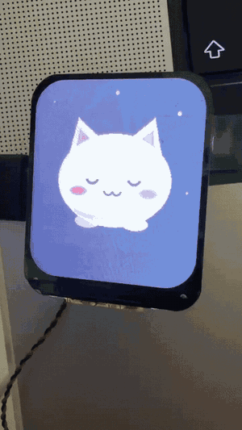
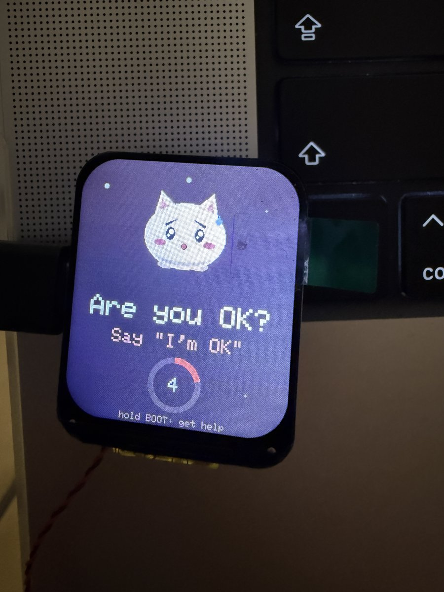

# Watch Me Charm prototype (ESP32-C6 board)

A stand-in for Meta's Muse Charm, made during the hackathon on a Waveshare ESP32-C6 1.69" LCD board (240×280 ST7789 screen, ES8311 codec with a microphone and a speaker on the MX1.25 connector). It is the always-on microphone for the Watch Me server. Its screen shows **Momo**, a round mochi cat drawn from shapes ([avatar.h](watchme-charm/avatar.h)).

<p>


</p>

To film it without speaking, [momo_demo.py](momo_demo.py) plays the demo's scenes from the Mac's speakers and prints each step: "Watch me", the drink pressure, "Are you OK?", the alert (dry run), and "stop watching".

**Stealth.** Momo looks the same whether Watch Me is listening or not, so nothing tells anyone nearby. The only hint is for her: while it is watching, the sparkles in Momo's eyes are tiny hearts. The only Watch Me screen it ever shows is "Are you OK?", with a countdown, because she has to see it to answer.

- **Voice only, as in the app.** Start, stop and "I'm OK" are all by her voice. Holding BOOT for 1.5 s during "Are you OK?" asks for help.
- **Spoken prompt.** On a check-in the speaker says "Are you OK? Say I'm OK."
- **Screens:** connecting (sleepy, with "z"s), idle, "Are you OK?", and relieved.

## Two ways to reach the server

| `LINK_USB` | How | When |
|---|---|---|
| `0` | Wi-Fi, a WebSocket straight to the server's `/ws`, exactly like the phone app | the board can join a 2.4 GHz network |
| `1` | the USB cable, through [bridge.py](bridge.py) on the Mac | no Wi-Fi, or to keep it tethered for a demo |

The USB link frames everything as `A5 5A, type, length (2 bytes LE), payload`. Frames from the board end with a CRC-16, so the bridge drops any frame the link damaged instead of passing scrambled audio to the voiceprint. Audio is 16 kHz PCM16, sent in 0.25 s blocks; the bridge joins each 4-second chunk and sends it to the server as one message, and only whole chunks (all 16 blocks, in order) go through.

## Build and run

1. `cp watchme-charm/config.example.h watchme-charm/config.h` and fill it in. `config.h` is gitignored because it holds the Wi-Fi password.
2. Install the [arduino-cli](https://arduino.github.io/arduino-cli/), the esp32 core (3.3.x), and the libraries "GFX Library for Arduino" and ArduinoJson.
3. Build and flash:
   ```
   arduino-cli compile --fqbn "esp32:esp32:esp32c6:CDCOnBoot=cdc,FlashSize=16M,PartitionScheme=app3M_fat9M_16MB" watchme-charm
   arduino-cli upload  --fqbn "esp32:esp32:esp32c6:CDCOnBoot=cdc,FlashSize=16M,PartitionScheme=app3M_fat9M_16MB" -p /dev/cu.usbmodem1101 watchme-charm
   ```
4. Start the server: `cd app && ./run.sh --lan`.
5. With `LINK_USB 1`, start the bridge. Run it with `--enroll` the first time and say the one line once to record your voice through the board's microphone:
   ```
   uvx --with pyserial --with websockets python device/bridge.py /dev/cu.usbmodem1101 --enroll
   ```
6. Say "Watch me". Close any Watch Me browser tab first: the server talks to one screen at a time.

## Credits

[es8311.cpp, es8311.h, es8311_reg.h](watchme-charm/) are Espressif's ES8311 codec driver (Apache-2.0), as shipped in Waveshare's examples for this board. The pin map comes from the board's published configuration. Everything else in this folder was written during the hackathon.
