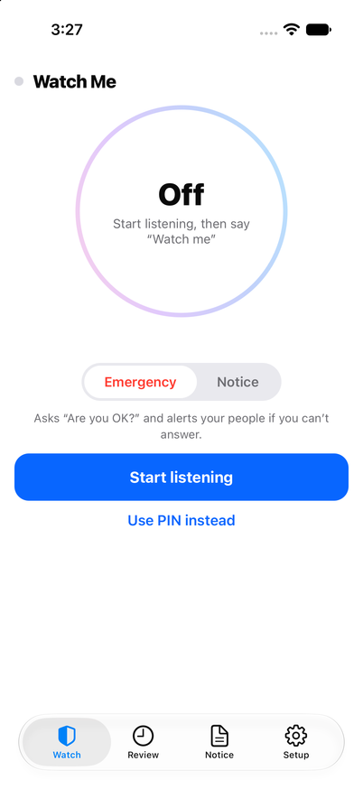
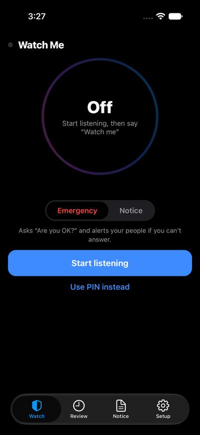
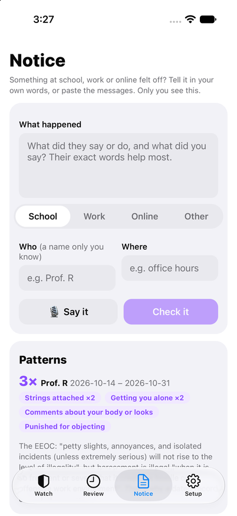
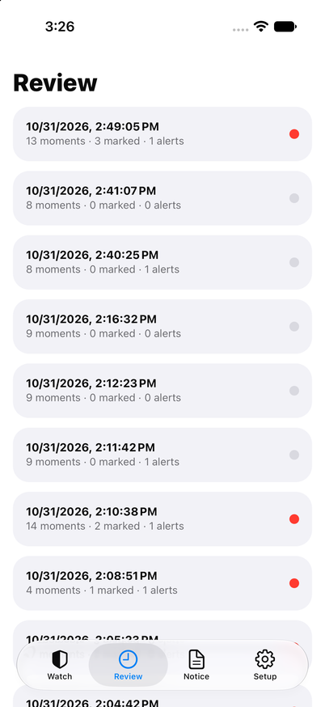
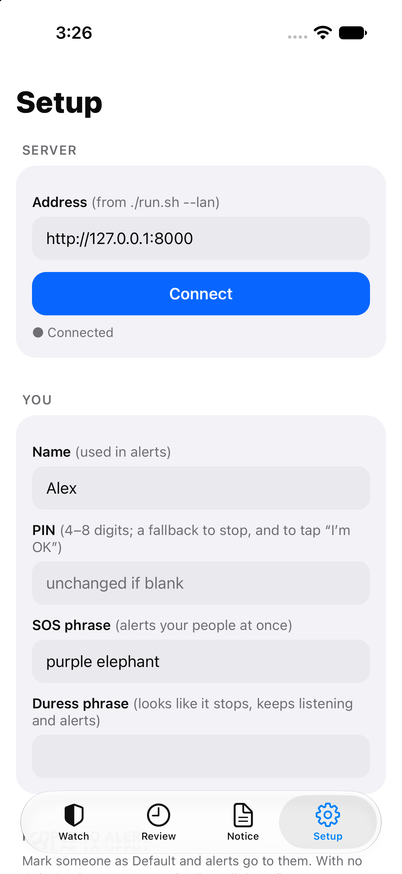

# Watch Me for iPhone and Android

The phone app for Watch Me, in React Native with Expo (SDK 58). It speaks the same protocol as the web page in `app/static/`, so the server and its agents don't change. What the native app adds is **listening with the screen locked**:
- **iOS:** the `audio` background mode.
- **Android:** a microphone foreground service, with its persistent "recording" notification.

<p>





</p>

| Tab | What it does |
|---|---|
| **Watch** | The orb, Emergency or Notice, start and stop listening, the voice-lock gauge, the live transcript, alerts. "Are you OK?" appears over every tab, plays the spoken prompt and vibrates. |
| **Review** | Past sessions, colour-coded, with the hash-chain check. |
| **Notice** | "Tell me what happened": typed, pasted or spoken. Shows which words match the EEOC's descriptions, and patterns per person. |
| **Setup** | The server address, you, the people to alert (default contacts, else family), your voice, and the models in use. |

## How it feels

| Interaction | What happens |
|---|---|
| **Hold the orb** | A ring fills around it for 0.7 s, then listening starts with a firm tap. Let go early and nothing happens. The button below does the same in one tap. |
| **The orb breathes** | It swells slightly with the room's loudness, and turns faster when it's watching. |
| **Your voice decides** | A success buzz and a green toast when "Watch me" or "I'm OK" is verified as you. An error buzz, a red toast and a shaking voice lock when another voice is refused. |
| **The voice gauge glides** | The match arc and percentage animate to each new reading. |
| **What it heard** | New lines slide in at the top; alerts spring in. |
| **"Are you OK?"** | A warning buzz and vibration and the spoken prompt. Only her voice can answer "I'm OK": no button or slide, so whoever holds the phone can't dismiss it. The one button is "Get help now". |
| **Every press** | Buttons give a little under the finger, with a light tick. |

The web page in `app/static/` has the same hold and enter animations. It vibrates where the browser supports it; iPhone browsers don't.

## Run it

1. **Start the server** on your Wi-Fi from the repo:

   ```bash
   cd app && ./run.sh --lan     # prints the address to enter in the app, e.g. 192.168.1.20:8000
   ```

2. **Build the app.** It uses native modules, so it needs a development build; Expo Go won't work.

   ```bash
   cd mobile
   npm install
   npx expo run:ios        # simulator or a connected iPhone (Xcode, CocoaPods)
   npx expo run:android    # emulator or a connected phone (Android Studio, JDK 17)
   ```

   Without a Mac or Android Studio, Expo can build it in the cloud: `npx eas-cli@latest build:configure` once, then `npx eas-cli@latest build --profile development`.

3. **In the app, open Setup.**
   - **Server:** enter the address from step 1 and tap Connect. For a development build, `EXPO_PUBLIC_SERVER_URL=192.168.1.20:8000 npx expo run:ios` fills it in.
   - **You and your people:** fill in your details and contacts, and save.
   - **Your voice:** tap Record my voice and say the one line shown, once.
4. **Go to Watch.** Tap Start listening and say "Watch me".

## How it works

| File | What it is |
|---|---|
| `src/lib/watchme.tsx` | The one connection to the server, shared by all tabs. It holds the WebSocket (with reconnect) and the microphone stream: `expo-audio`'s `useAudioStream`, mono 16-bit PCM, resampled to 16 kHz if the hardware delivers another rate and sent in 4-second chunks. It also handles every server event, the spoken prompts and location. |
| `src/lib/pcm.ts` | Resampling, chunking, loudness and base64, matching what the web page sends |
| `src/lib/server.ts` | The server address, kept in the device's secure storage, and the REST calls |
| `src/components/` | The orb, the voice-match gauge, the "Are you OK?" sheet |
| `src/app/` | The four tabs (Expo Router, native tabs) |
| `assets/voice/` | The app's spoken prompts, the same files as `app/static/voice/` |
| `app.json` | Permissions and background modes, set through config plugins. `ios/` and `android/` are generated by `npx expo prebuild` and not committed. |

## Checked

- **Code:** `npx tsc --noEmit` and `npx expo lint` are clean; `npx expo-doctor` passes 20 of 20 checks.
- **Generated settings:** `npx expo prebuild` produces the iOS `audio` background mode, the microphone explanation and local-network access, and on Android the microphone foreground service, cleartext on the local network, vibration and location.

## Not done yet

- **Location in the background:** location is foreground-only. With the screen locked, an alert carries the last place the phone was seen, labelled with the time it was taken ("last known, at 23:14, 6 min ago").
- **A notification for "Are you OK?":** with the screen locked she hears the prompt and can answer by voice, but no notification appears yet (that needs `expo-notifications`).
- **No connection to the server:** the server treats a phone that drops off as a missed check-in and alerts; the app doesn't keep audio itself while disconnected.
- **Release builds:** there's no signing set up yet for TestFlight or the Play Store.
